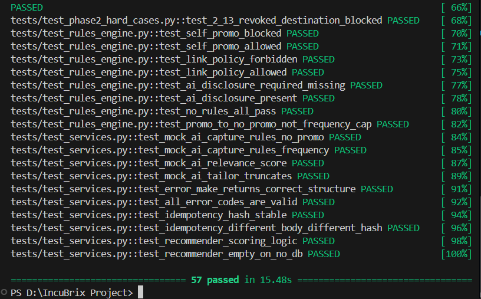

# IncuBrix Test Suite Verification Evidence

This directory contains verified execution evidence for the IncuBrix Long-Tail Distribution test suite.

## Pytest Execution Summary

All 57 test cases pass with a 100% pass rate in 15.48 seconds.

### Verified Test Areas:
1. **Core API Health & Routing** (`tests/test_core.py`):
   - `/health`, `/ready`, `/api/v1/connectors`, `/connector/v1/{key}/validate`
   - Strict standard error envelope format validation
   - OpenAPI 3.1 specification parity

2. **Phase 2 Hard Cases & Resilience** (`tests/test_phase2_hard_cases.py`):
   - Idempotency replay with cryptographic key deduplication
   - Circuit breaker opening on consecutive 5xx failures with automatic recovery
   - Anti-spam multi-lingual promotional blocking
   - Mandatory AI disclosure enforcement
   - Expired token mapping to `CONNECTION_AUTH_EXPIRED`
   - Destination specification violations to `DEST_SPEC_VIOLATION`
   - Bounded CSV import with error reporting

3. **Rules & Anti-Spam Compliance** (`tests/test_rules_engine.py`):
   - Self-promotional links detection
   - Link placement policy checks
   - AI generation disclosure checks
   - Fail-closed database error handling

4. **Metrics Collection** (`tests/test_metrics.py`):
   - Dev.to, Discourse, Lemmy, and Ghost normalized metrics collection

5. **AI Recommender & Services** (`tests/test_services.py`):
   - Recommender scoring and ranking logic
   - Deterministic offline mock AI adapter
